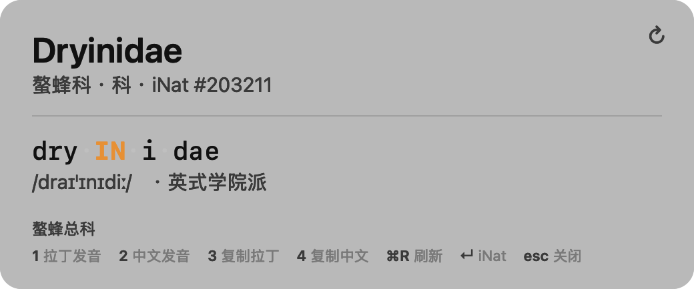
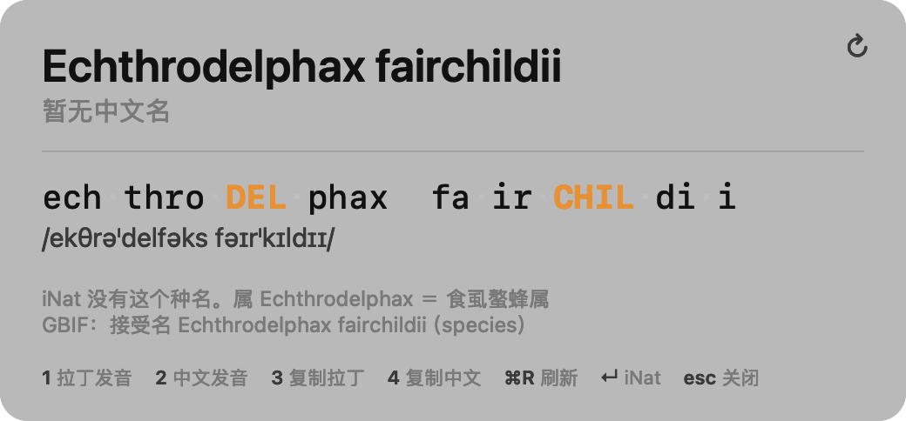
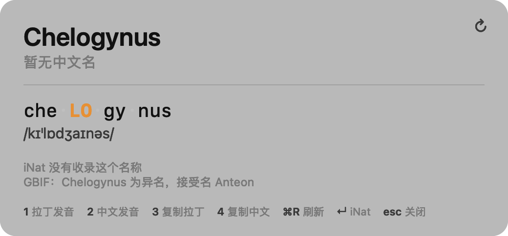
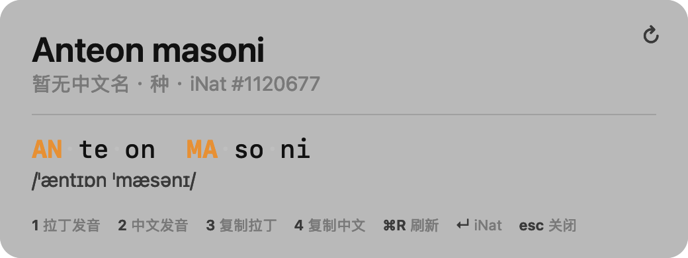
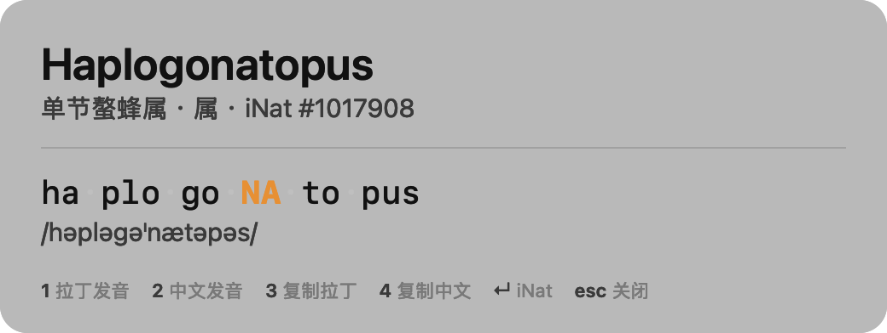
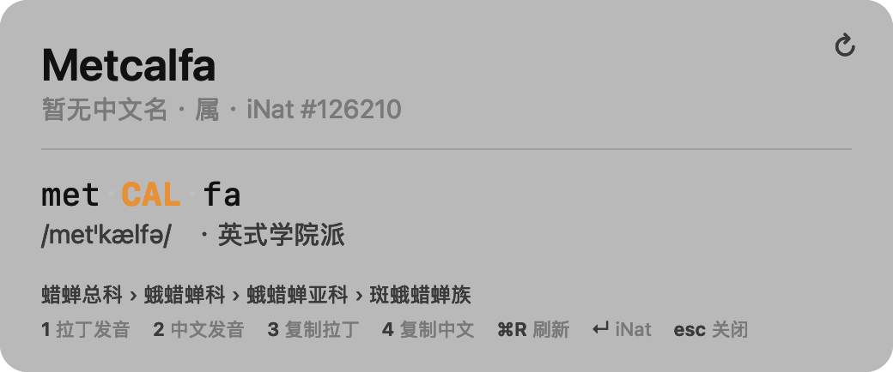

# 拉丁名助手 · LatinName Helper

macOS 菜单栏小工具：选中一个学名或中文名，按 **⌘4**，立刻看到它的读音和中文名。

A tiny macOS menu-bar app for taxonomists: select a scientific name (or a Chinese
name), hit ⌘4, and get its pronunciation and iNaturalist Chinese name.



---

## 功能

- **双向查询**：拉丁名 → 中文名，中文名 → 拉丁名，中文名以 [iNaturalist](https://www.inaturalist.org) 为准
- **读音拆解**：音节切分、主重音、IPA，支持三种发音习惯（英式学院派 / 教会式 / 恢复古典）
- **上级分类链**：顺手给出「总科 › 科 › 亚科 › 族」，查不到中文名时也能知道这东西大概是什么
- **朗读**：1 读拉丁名，2 读中文名
- **复制**：3 复制拉丁名，4 复制中文名
- **兜底**：iNat 没收录时，退一级给属的中文名，并让 GBIF 判断这个名字是否真实有效
- **离线缓存**：查过的不重复联网，⌘R / 面板右上角 ↻ 可强制刷新

## 截图

| iNat 没这个种名 | GBIF 判为异名 |
|---|---|
|  |  |

| iNat 有但没有中文名 | 中文名反查拉丁名 |
|---|---|
|  |  |

没有中文名时，底部会给上级分类链，比如 `Metcalfa` → `蜡蝉总科 › 蛾蜡蝉科 › 蛾蜡蝉亚科 › 斑蛾蜡蝉族`：



## 用法

| 操作 | 效果 |
|---|---|
| 选中文字 + **⌘4** | 弹出面板 |
| **1** / 空格 | 读拉丁名 |
| **2** | 读中文名 |
| **3** | 复制拉丁名 |
| **4** | 复制中文名 |
| **⌘R** | 跳过缓存重新联网 |
| **↵** | 打开对应的 iNat 页面 |
| **esc** | 关闭 |

选中内容是中文就走中文反查，是拉丁就走拉丁查中文，不用切模式。会自动剥掉命名人、年份、
括号，并接上 PDF 复制导致的断行连字符（`Gonato-` ↵ `pus` → `Gonatopus`）。

## 安装

要求 macOS 13+、Xcode Command Line Tools（`xcode-select --install`）。

```bash
git clone https://github.com/<你的用户名>/latin-name-helper.git
cd latin-name-helper
./build.sh      # 编译到 build/，不在工程目录生成 .app
./install.sh    # 安装到 ~/Applications 并启动
```

首次按 ⌘4 会请求「辅助功能」权限，去「系统设置 → 隐私与安全性 → 辅助功能」勾选即可。
读取选中文字必须这个权限；部分 Electron 应用读不到时会自动退化为「模拟 ⌘C → 读剪贴板」。

### 关于签名（建议做一次）

macOS 按「路径 + 代码签名要求」记授权。脚本默认用 ad-hoc 签名，**每次重新编译授权都会失效**，
权限列表里还会堆出多条同名记录。想让授权长期有效，做一张本机自签名证书并信任它：

```bash
# 1. 造证书（CN 要与 install.sh 里的 SIGN_ID 一致）
openssl req -x509 -newkey rsa:2048 -keyout key.pem -out cert.pem -days 3650 -nodes \
  -subj "/CN=LatinName Local Signing" \
  -addext "basicConstraints=critical,CA:false" \
  -addext "keyUsage=critical,digitalSignature" \
  -addext "extendedKeyUsage=critical,codeSigning"
openssl pkcs12 -export -out cert.p12 -inkey key.pem -in cert.pem -passout pass:latin

# 2. 导入登录钥匙串
security import cert.p12 -k ~/Library/Keychains/login.keychain-db -P latin -T /usr/bin/codesign -A

# 3. 在「钥匙串访问」里找到 LatinName Local Signing → 显示简介 → 信任 → 代码签名「始终信任」
```

之后 `./install.sh` 会自动优先用这张证书签名；换证书用环境变量
`LATINNAME_SIGN_ID="你的证书名" ./install.sh`。

## 读音是怎么算出来的

1. **分词**：`ch/ph/th/rh` 视为单辅音，`ae/oe/au/eu/ei` 视为双元音
2. **切音节**：单辅音归后一个音节；塞音+流音（`tr`、`pl`…）作音节首；其余分割
3. **定重音**：倒数第二音节为长则重读它，否则重读倒数第三；`-idae / -inae / -ini` 固定重读倒数第三；`-atus / -alis / -ensis` 等长元音词尾单独处理
4. **出 IPA**：英式学院派（`-idae` = /ɪdiː/，`ae` = /iː/，`c` 在 e/i/y 前 = /s/）
5. **合成音**：把 IPA 转写成英文拼写给 `AVSpeechSynthesizer` 的英式语音朗读

以螯蜂科几个常见名称为例：

| 学名 | 音节·重音 | IPA |
|---|---|---|
| Dryinidae | dry·**IN**·i·dae | /draɪˈɪnɪdiː/ |
| Chalcidoidea | chal·ci·**DO**·i·de·a | /kælsɪˈdɒɪdɪə/ |
| Pteromalidae | pte·ro·**MAL**·i·dae | /ptɪrəˈmælɪdiː/ |
| Gonatopus | go·**NA**·to·pus | /ɡəˈnætəpəs/ |
| Echthrodelphax | ech·thro·**DEL**·phax | /ekθrəˈdelfəks/ |


## 三种发音习惯

菜单栏图标 →「发音习惯」切换，选择会存进配置，面板上 IPA 后面会标出当前用的是哪一套。

| 方案 | Dryinidae | 说明 |
|---|---|---|
| 英式学院派 | /draɪˈɪnɪdiː/ | 英美昆虫学者日常口语，`-idae` 读 /ɪdiː/，`ae` 读 /iː/ |
| 教会式（意式） | /driˈinide/ | 欧洲大陆传统，单元音不弱化，`c` 在 e/i 前读 /tʃ/；用意大利语音朗读 |
| 恢复古典 | /dryˈinidae̯/ | 古典学读法，二合元音读成双元音 /ae̯/，`c` 一律 /k/，`v` 读 /w/ |

音节切分和重音位置三套一致，变的只是音值。

## 上级分类链

查到条目后会自动再取一次它的上级链，面板上显示一行：

```
蜡蝉总科 › 蛾蜡蝉科 › 蛾蜡蝉亚科 › 斑蛾蜡蝉族
```

- 只取 `总科 / 科 / 亚科 / 族 / 亚族 / 属` 这几级，名称优先用 iNat 中文名，没有就显示拉丁名
- 链条太短（只剩一条）时，自动补上目一级
- 缓存 `ancestors.json`，同一分类单元不重复请求

## 数据来源

- **中文名**：iNaturalist `api.inaturalist.org/v1/taxa/autocomplete?locale=zh-CN`
- **名称有效性**：GBIF `api.gbif.org/v1/species/match`（仅在 iNat 查不到时调用）

两者都免费、无需 API key。结果缓存在 `~/Library/Application Support/LatinNameHelper/`：

| 结果 | 缓存时长 |
|---|---|
| 有中文名 | 30 天 |
| 无中文名 | 10 分钟 |
| iNat 未收录 | 30 分钟 |

每次启动会丢弃「没有中文名」的缓存，所以隔天打开基本不会读到过期结果。

## 配置

`~/Library/Application Support/LatinNameHelper/config.json`（首次运行自动生成）：

```json
{
  "latinVoice": "Daniel",
  "chineseVoice": "Tingting",
  "rate": 160,
  "hotKeyCode": 21,
  "hotKeyModifiers": 256,
  "scheme": "british",
  "ecclesiasticalVoice": "Alice"
}
```

`hotKeyCode` 21 是键盘 4，`hotKeyModifiers` 256 是 ⌘。换成 ⌘⌥4 用 `256+2048`。
`scheme` 可选 `british` / `ecclesiastical` / `classical`；教会式用 `ecclesiasticalVoice`（默认 Alice，意大利语音）。

## 已知限制

1. **元音长短不标**，重音靠规则推算。希腊词源、人名纪念名（`fairchildii`、`nielseni`）会出错
2. **音频是近似**。面板上的音节和 IPA 才是准的；合成音只保证音节与重音对
3. **中文名覆盖率取决于 iNat**。种级常显示「暂无中文名」，这是数据现状
4. **GBIF 的接受名是 GBIF 自己的分类观点**，与 iNat 不一致，也不能替代分类学判断
5. **⌘4 是全局抢占**，浏览器里「切到第 4 个标签」会失效
6. 只在 macOS 上验证过

## 目录结构

```
Sources/
  LatinEngine.swift   音节 / 重音 / IPA / 英语转写
  INatClient.swift    iNat 查询 + 缓存
  GBIF.swift          GBIF 名称校验
  HotKey.swift        全局快捷键 + 取选中文字
  HUD.swift           面板界面
  Speech.swift        语音合成 + 配置
  AppDelegate.swift   主流程
  Probe.swift         命令行诊断
  main.swift          入口
build.sh              编译（产出 build/LatinName，不生成 .app）
install.sh            安装到 ~/Applications
```

命令行诊断（不开界面，直接查一个名字）：

```bash
./build/probe --probe "Dryinidae"
./build/probe --probe "螯蜂科"
```

## License

MIT
